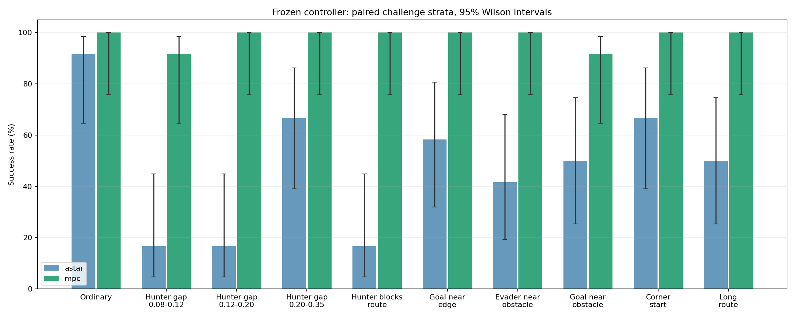
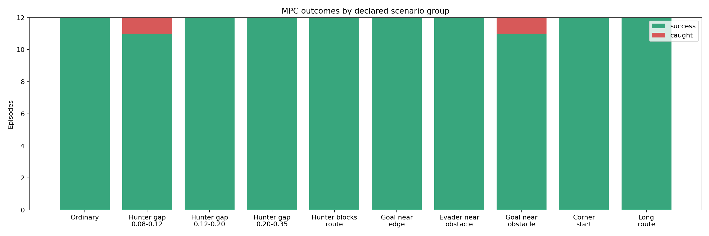
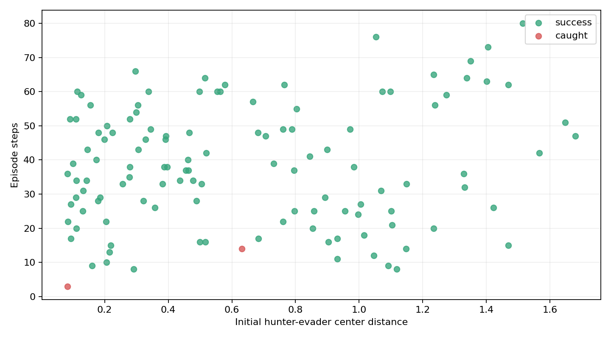

# 分层可行性测试报告（2026-10-13）

## 设计与冻结范围

在此前 100 个普通随机场景之外新增 10 类场景，每类 12 个，共 120 个不同初始位置。每个位置分别运行 A* 跟踪与完整 MPC，共 240 回合。使用旧正式测试的冻结 config.json；控制器与动力学代码未调参。新增的评测代码只记录分组与猎手碰障碍信息。

案例在运行前一次生成并保存，固定种子 20261013。初始红绿间距大于 0.075，初始绿球距障碍大于 0.080，猎手距障碍大于 0.085，目标距障碍大于 0.078，目标距两球均大于 0.15；坐标不超出 [-0.80,0.80]。拒绝的是几何不符合生成条件的初始案例，并未删去运行失败案例。各分组是生成条件标签，其他风险因素可能同时存在。

这是一组等额困难场景测试，整体成功率受分组比例影响，不代表真实考核位置的总体分布。每类仅 12 个样本，置信区间较宽，不能从 12/12 推断该类必然成功。

## 分组结果

| 场景类别 | A* 成功 | MPC 成功 | MPC 成功率及95%区间 | 被捕 | 撞障碍 | 超时 | 感知失败 |
|---|---:|---:|---|---:|---:|---:|---:|
| 普通随机位置（沿用旧范围） | 11/12 | 12/12 | 100.0% [75.7%, 100.0%] | 0 | 0 | 0 | 0 |
| 近距离追击：0.08～0.12 | 2/12 | 11/12 | 91.7% [64.6%, 98.5%] | 1 | 0 | 0 | 0 |
| 近距离追击：0.12～0.20 | 2/12 | 12/12 | 100.0% [75.7%, 100.0%] | 0 | 0 | 0 | 0 |
| 近距离追击：0.20～0.35 | 8/12 | 12/12 | 100.0% [75.7%, 100.0%] | 0 | 0 | 0 | 0 |
| 猎手位于起点到目标连线附近 | 2/12 | 12/12 | 100.0% [75.7%, 100.0%] | 0 | 0 | 0 | 0 |
| 目标靠边：单轴绝对值0.72～0.80 | 7/12 | 12/12 | 100.0% [75.7%, 100.0%] | 0 | 0 | 0 | 0 |
| 绿球靠障碍：中心距离0.082～0.11 | 5/12 | 12/12 | 100.0% [75.7%, 100.0%] | 0 | 0 | 0 | 0 |
| 目标靠障碍：中心距离0.08～0.12 | 6/12 | 11/12 | 91.7% [64.6%, 98.5%] | 1 | 0 | 0 | 0 |
| 绿球靠角：双轴绝对值0.73～0.80 | 8/12 | 12/12 | 100.0% [75.7%, 100.0%] | 0 | 0 | 0 | 0 |
| 远距离目标：起终点距离至少1.35 | 6/12 | 12/12 | 100.0% [75.7%, 100.0%] | 0 | 0 | 0 | 0 |







## 配对比较

同一个初始位置中，MPC 成功而 A* 失败：61 个；A* 成功而 MPC 失败：0 个。这是直接配对计数，不是独立场景平均值之差，也未据此声称统计显著。

## 猎手碰障碍与规则

按原 simple_tag.py，猎手碰障碍不触发结束；绿球碰障碍、被捕以及到达目标才是相关结束事件。物理引擎仍会对猎手与障碍的接触施加碰撞力，没有删除障碍或赋予穿越能力。碰障碍诊断在决策之后由独立评估器读取真值，不返回控制器。

接触的统计口径是每次 step 后猎手与任一障碍中心距离小于 0.075。视觉上看起来接触不一定达到这个物理阈值。这里只检查离散帧，不能排除帧间短暂接触。

| 方法 | 有猎手接触的回合 | 其中成功 | 无接触回合 | 其中成功 |
|---|---:|---:|---:|---:|
| astar | 15 | 13 | 105 | 44 |
| mpc | 17 | 17 | 103 | 101 |

上述接触与成功的关系是观察性统计，场景难度不同，不能证明因果关系。猎手当前控制逻辑来自老师原环境，没有修改规则。

## 全部 MPC 失败案例

| 案例 | 分组 | 原因 | 步数 | 初始猎手间距 |
|---|---|---|---:|---:|
| hunter_gap_008_012_007 | 近距离追击：0.08～0.12 | caught | 3 | 0.083 |
| near_obstacle_goal_000 | 目标靠障碍：中心距离0.08～0.12 | caught | 14 | 0.632 |

每个案例均有 trajectory.json、preview.png、final.png。失败可能来自距离过近、有限预测窗口、有限采样、视觉遮挡/误差或参考路线局限；不能仅凭失败轨迹断言问题数学上无解。

## 适用性结论

应依据分组表分别判断普通场景、近距离追击、靠边、靠障碍等情况。此前普通随机 100/100 只反映原范围，不替代本次分层测试，更不能保证考核满分。本次未根据结果修改控制参数，后续若优化需另建新的验证与测试清单。

## 复现

在项目主目录、已激活 multiagent-ml 的 Linux 终端运行：

```bash
python wsl-support/vision_mpc/run.py --mode compare --methods astar mpc \
  --cases wsl-support/vision_mpc/outputs/stratified_20261013/cases.json \
  --config wsl-support/vision_mpc/outputs/stratified_20261013/config.json \
  --output wsl-support/vision_mpc/outputs/stratified_reproduction
python wsl-support/vision_mpc/stratified_report.py wsl-support/vision_mpc/outputs/stratified_reproduction
```
