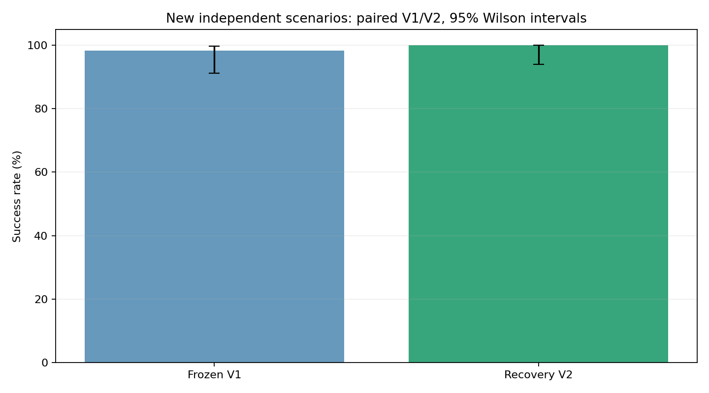

# MPC V2 优化与验证报告

## 改动与数据边界

保留旧控制器 controller_v1.py，哈希与原测试控制器一致。mpc_v1 调用旧版；mpc 默认调用 V2。原物理、追击、终止和图像识别规则未修改，不按案例 ID 或真实坐标设置特例。

旧版候选以朝全局路径的速度跟踪为中心，小扰动不一定能反向逃跑。V2 保留常规搜索，只有最优序列仍预测危险时才启动恢复搜索：相对当前视觉位置生成多方向、不同距离的临时避险点；允许先远离目标，若干步后重新接入 A* 路线；预测窗口扩展到 50 步。优先选预测安全候选；若全部危险，则优先延长预计存活时间。

两个原失败案例参与了策略设计，原 120 场分层案例和 100 场普通案例均作为回归集，不再把它们作为 V2 的独立泛化证据。另用新种子 2026101302、每组 6 场共 60 场做独立配对测试；报告所有失败，不根据独立结果继续调参。

## 已知失败修复

| 案例 | V1 | V2 | V2 步数 | 恢复决策次数 |
|---|---|---|---:|---:|
| hunter_gap_008_012_007 | caught | success | 45 | 5 |
| near_obstacle_goal_000 | caught | success | 19 | 9 |

## 回归结果（不是独立测试）

| 数据集 | V1 成功 | V2 成功 | V2 结束原因 |
|---|---:|---:|---|
| 原分层 120 场 | 118/120 | 120/120 | {'success': 120} |
| 原普通 100 场 | 100/100 | 100/100 | {'success': 100} |

## 新独立配对测试

| 版本 | 成功 | 成功率 | 95% Wilson 区间 | 结束原因 |
|---|---:|---:|---|---|
| mpc_v1 | 59/60 | 98.3% | 91.1%–99.7% | {'caught': 1, 'success': 59} |
| mpc | 60/60 | 100.0% | 94.0%–100.0% | {'success': 60} |

配对中 V2 成功而 V1 失败 1 场，V1 成功而 V2 失败 0 场。样本量有限，不根据置信区间重叠或两例修复就声称统计上必然优于旧版。



## 计算开销

| 版本 | 各回合中位耗时的中位数/ms | 有恢复决策的回合 |
|---|---:|---:|
| mpc_v1 | 101.62 | 0 |
| mpc | 102.24 | 6 |

恢复搜索增加计算量；常规回合保留旧算法。耗时包含图像渲染和首次规划，不保证 0.1 秒的硬实时截止。恢复搜索也不保证所有候选中一定存在安全轨迹。

## 独立测试中的全部 V2 失败

| 案例 | 分组 | 原因 | 步数 |
|---|---|---|---:|
| 无 | — | — | — |

## 复现

在项目主目录、Linux multiagent-ml 环境中：

```bash
python wsl-support/vision_mpc/run.py --mode compare --methods mpc_v1 mpc \
  --cases wsl-support/vision_mpc/outputs/v2_independent/cases.json \
  --config wsl-support/vision_mpc/outputs/v2_independent/config.json \
  --output wsl-support/vision_mpc/outputs/v2_reproduction
```

重放旧版带 mpc 标签的历史实验时增加 --controller-version v1。旧 CSV、轨迹和报告保留。
