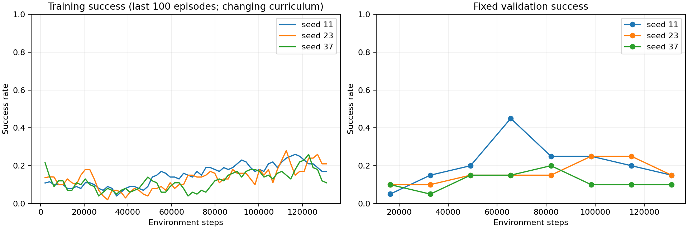
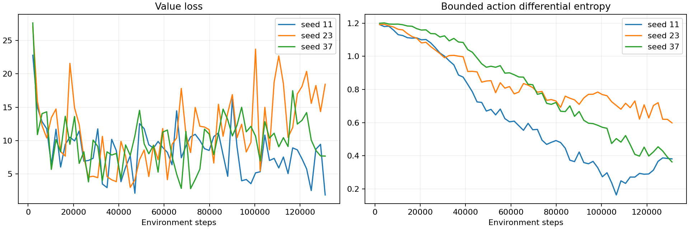
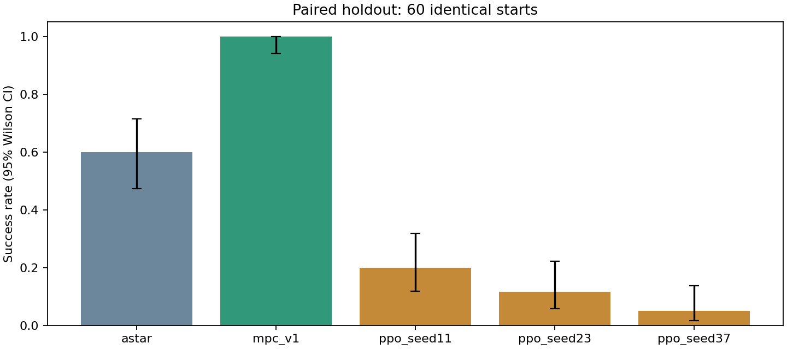

# 视觉状态 PPO 实现与独立对照实验

## 实验设置

- 随机种子：[11, 23, 37]；每个种子训练 131,072 步，总训练预算 393,216 步。
- CPU PyTorch；独立 on-policy PPO，无 MPC 示范或预训练。
- 800×800 原环境 RGB 图像；颜色分割及连续帧差分得到 21 维状态。真实坐标仅用于终止判定，不输入策略。
- 两个 128 单元隐藏层，tanh 高斯策略；保留动作幅度、原一步延迟及原物理规则。
- 训练前 35% 预算逐步增加初始场景难度，之后随机混合；没有修改追击规则。
- 20 个固定验证场景选检查点；最终测试在全部模型冻结后生成。
- 最终测试：60 个新随机场景，seed=6101399；每回合上限 500 步。
- 所有方法通过同一 VisualEnv，使用相同感知、初始化、动作约束和结果判定。
- MPC 对照明确使用 controller_v1，对应原版算法；不将新实验与已有测试集混合。
- 奖励：成功 +20，真实终止失败 -20，每步 -0.01，目标距离势函数 Φ=-5×距离；使用 γΦ(s′)-Φ(s) 塑形。
- 超参数：学习率 0.0003，γ=0.99，GAE λ=0.95，裁剪 0.2，rollout=2048，batch=256，每批最多 10 轮更新，熵系数 0.005，梯度范数上限 0.5，KL 提前停止阈值 0.02。

## 独立测试结果

| 方法 | 成功 | 成功率（95%区间） | 被捕 | 撞障碍 | 超时 | 感知失败 | 其他失败 | 成功平均步数 | 控制中位耗时均值 ms | 含视觉单步中位耗时均值 ms |
|---|---:|---|---:|---:|---:|---:|---:|---:|---:|---:|
| astar | 36/60 | 60.0%（47.4%～71.4%） | 12 | 12 | 0 | 0 | 0 | 32.6 | 0.067 | 14.109 |
| mpc_v1 | 60/60 | 100.0%（94.0%～100.0%） | 0 | 0 | 0 | 0 | 0 | 37.4 | 49.429 | 64.209 |
| ppo_seed11 | 12/60 | 20.0%（11.8%～31.8%） | 15 | 33 | 0 | 0 | 0 | 104.3 | 0.278 | 14.168 |
| ppo_seed23 | 7/60 | 11.7%（5.8%～22.2%） | 31 | 22 | 0 | 0 | 0 | 63.0 | 0.278 | 14.113 |
| ppo_seed37 | 3/60 | 5.0%（1.7%～13.7%） | 30 | 27 | 0 | 0 | 0 | 79.3 | 0.285 | 14.786 |

3 个 PPO 训练种子的测试成功率均值为 12.2%，种子间样本标准差为 7.5%。同一测试场景在不同种子中重复使用，不能把它们当作完全独立的三倍测试样本。

## 模型选择与配对差异

仅依据验证集选择演示模型：**ppo_seed11**，检查点训练步数 65,536，验证成功率 45.0%。
各检查点路径及 SHA-256 位于 holdout/manifest.json。
- 对 astar：PPO 独有成功 4 场，对照独有成功 28 场，配对成功率差 -40.0%。
- 对 mpc_v1：PPO 独有成功 0 场，对照独有成功 48 场，配对成功率差 -80.0%。

## 结果解释与限制

本轮 PPO 的独立测试成功率低于 MPC，未证明其能够替代或增强 MPC；它已形成可复现的深度强化学习对照。
- 已完成固定预算训练；不据此声称策略已收敛或达到最优。
- 成功平均步数只统计成功回合，不能脱离成功率单独比较效率。
- 耗时为同一运行环境下各回合中位数的均值；训练并行、最终评估串行，视频和文件写入不计入控制计时。
- 含视觉单步耗时包括策略、物理推进、渲染和识别；控制耗时仅包括策略或规划计算。
- 上述单步耗时不含回合初始化、网络加载和初始地图构建。
- 训练曲线采用不断变化的课程场景，泛化判断以固定验证与独立测试为准。
- 图像识别失败计入结果，不使用真实状态补齐。

## 图表







## 复现

在项目根目录、WSL multiagent-ml 环境运行：

```bash
python -m unittest discover -s wsl-support/vision_ppo/tests -v
python wsl-support/vision_ppo/run_experiment.py --output wsl-support/vision_ppo/outputs/reproduction --steps 131072 --test-count 60
```

最终结果逐场数据：holdout/results.csv；训练日志：seed*/train.csv；验证日志：seed*/validation.jsonl。
